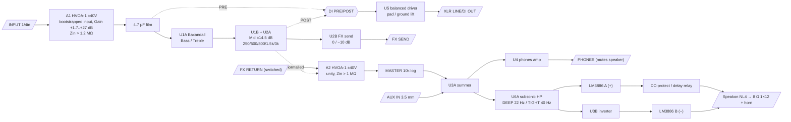
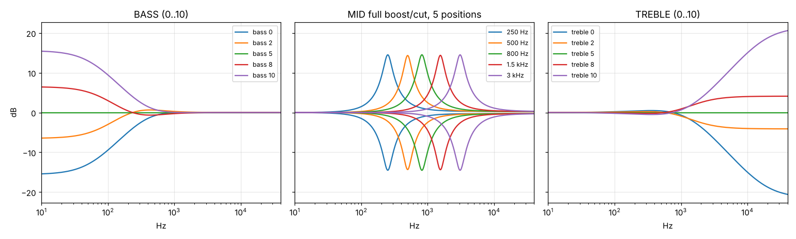
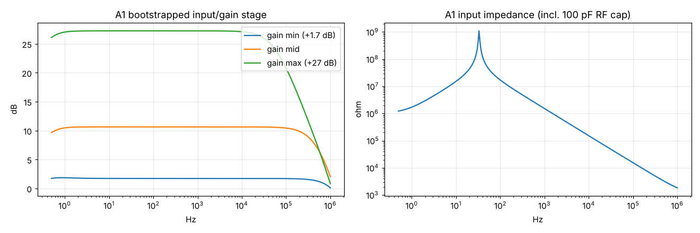
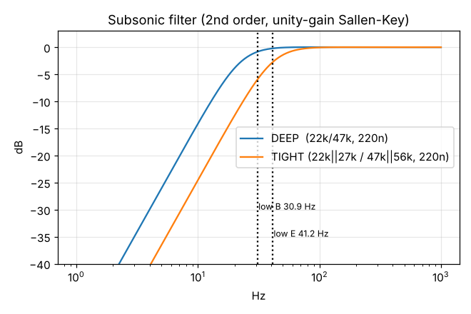

# 130 W bass amplifier: discrete HV front end, NE5532 EQ, LM3886 bridge output

This is a complete design for a bass amplifier head that drives an 8 Ω 1×12" + horn cabinet.

- **Front end:** discrete, running on ±40 V rails. Nested-cascode MPSA42/MPSA92 stages surround 2N5087/2N5210 low-noise signal transistors.
- **EQ and line/FX/phones I/O:** NE5532.
- **Output stage:** two LM3886 chips in bridge (BTL). This is linear class AB, not class D.
- **Construction:** every part is through-hole.

The HV op-amp module and the EQ were designed and checked in ngspice. Everything in `sim/` can be re-run. The numbers quoted below come from those simulations unless a line says otherwise.

> **Assumptions, so you can correct me**
> 1. "12 inch speaker plus a cone" is read as a 2-way cabinet: an 8 Ω 12" woofer plus a horn or tweeter, with a passive crossover (section 12).
> 2. "Headphones input" is read as a **headphone output** plus an **aux input** for practice (3.5 mm, mixed into phones and speaker).
> 3. "Bootstrapped DI input" is read as a high-impedance, bootstrapped instrument input. A balanced DI/line output follows it, with pre/post-EQ select, ground lift and a −20 dB pad.
> 4. The cabinet is **8 Ω**. For a 4 Ω cabinet, see section 9.3.

---

## 1. Why this architecture

| Decision | Choice | Reason |
|---|---|---|
| Power stage | **2 × LM3886T in bridge (BTL)**, ±28 V rails | In bridge mode each chip sees half the load (8 Ω → 4 Ω each). That is exactly the condition TI rates the LM3886 for (68 W/4 Ω @ ±28 V). Two of them give ≈ 130 W into 8 Ω, comfortably above the 100 W minimum. The LM3886 is in production, through-hole (TO-220-11), and has SPiKe protection: SOA, thermal, over-voltage and short-circuit. |
| Rejected: single TDA7293/TDA7294 | – | One chip into 8 Ω only reaches ≈ 80 W before clipping, which is below spec. |
| Rejected: paralleled chips | – | Needs a 4 Ω load to reach 100 W. |
| Front end | Discrete **HVOA-1** module on **±40 V** | Clips at **+30 dBu (25.5 Vrms)**. Active basses, hot boosts and FX returns can never clip it, so no pad switch is needed. |
| Why the cascodes are needed | MPSA42/MPSA92 (300 V parts) | The 2N5087/2N5210 are 50 V parts and could not survive 80 V rails on their own. The cascodes hold the 2N5087 input pair at a constant 4.7 V V<sub>CE</sub> and the 2N5210 VAS at 2 V V<sub>CE</sub>. |
| What "nested" means here | Cascodes at both gain stages | The input-pair cascode is **bootstrapped** to the tail node, so it follows the input common-mode. The VAS cascode sits inside the same loop. Both are inside one dominant-pole loop. |
| EQ | NE5532 Baxandall (bass/treble) + gyrator mid with a 5-way frequency switch | This is the classic, quiet, low-parts-count solution. NE5532 is a good fit here: it drives 600 Ω. |
| I/O | NE5532 for FX send, balanced out and phones; HVOA for both *inputs* (instrument and FX return) | Every external input gets the +30 dBu headroom. The outputs only need to drive cables, and NE5532 is the better tool for that. |
| Supplies | Separate small transformer for ±40 V; discrete series regulators | A common 3-pin regulator such as the LM317 is limited to 40 V input-to-output, so the HV rails need a discrete design anyway. The ±15 V rails are also discrete, so the design has no 3-pin regulators at all. |

---

## 2. Block diagram



---

## 3. Specifications

| Parameter | Value | Source |
|---|---|---|
| Output power | ≈ 130 W into 8 Ω (BTL, ±28 V rails, stiff supply); ≥ 110 W with a 400 VA toroid sagging | Datasheet scaling (2 × 68 W/4 Ω) |
| Input impedance | > 1.2 MΩ at 0.5 Hz; tens of MΩ at 10–100 Hz; above 1 kHz the 100 pF RF cap sets it (≈ 1.6 MΩ at 1 kHz) | sim, `docs/a1_response.png` |
| Input gain | +1.7 dB … +27 dB (50 kA pot) | sim |
| Input clip level | 36 V<sub>pk</sub> = **+30.3 dBu** at the A1 output, so up to 25 Vrms at the jack at minimum gain | sim |
| A1 THD at 20 Vrms out, max gain | 0.00016 % @ 1 kHz, 0.006 % @ 40 Hz, 0.05 % @ 10 kHz | sim (`t_final.cir`) |
| A2 THD at 20 Vrms, unity | 0.00006 % @ 1 kHz, 0.0006 % @ 10 kHz | sim |
| HVOA open-loop gain / UGF / phase margin | ≈ 100 dB @ 20 Hz / ≈ 2 MHz / **58°** (10 k ‖ 220 pF load) | sim (`t_loop.cir`) |
| Noise (A1, passive pickup 8 k + 3 H, gain ×5.5) | 58 µV A-wtd at the A1 output, i.e. ≈ 89 dB SNR for a 300 mV pickup. This is 9 dB above the pickup's own thermal noise. | sim (`noise_eval.py`) |
| Bass | ±14.4 dB @ 30 Hz, ±13.7 dB @ 40 Hz, ±9.4 dB @ 100 Hz (shelf) | sim |
| Mid | ±14.5 dB peak, Q ≈ 1.6, at 250 / 500 / 800 / 1.5 k / 3 kHz (switched) | sim |
| Treble | ±10 dB @ 5 kHz, ±15 dB @ 10 kHz (shelf) | sim |
| Subsonic filter | 2nd order: DEEP −3 dB @ 22 Hz (−0.8 dB at low B, 31 Hz) / TIGHT −3 dB @ ≈ 40 Hz | calc, `docs/subsonic.png` |
| Balanced out | Pre/post EQ, +2 dBu nominal, max +26 dBu differential, −20 dB pad, ground lift, phantom-safe | design |
| FX loop | Send 0 / −10 dB switch; return into an HV stage (+30 dBu headroom) | design |
| Phones | NE5532 per side, 47 Ω build-out, 32–600 Ω phones; plugging in mutes the speaker | design |

A note on noise: a BJT input on a passive, inductive bass pickup is inherently noisier than a JFET or tube input. The base-current shot noise works against the pickup's high impedance at resonance. The A1 module therefore runs its input pair at only 125 µA per side, and its bias resistor is bootstrapped to 1 MΩ. Even so, it ends up ≈ 9 dB above the pickup's thermal noise. In absolute terms ~89 dB A-weighted SNR is quieter than the hum any single-coil bass pickup picks up, so it does not matter in practice. Hand-select 2N5087s with h<sub>FE</sub> ≥ 400 to shave another 1–2 dB.





---

## 4. Gain structure

| Point | Nominal | Clips at | Headroom |
|---|---|---|---|
| Passive bass at jack | 300 mVrms (−8 dBu) | – | – |
| A1 out (gain set to ×3.3) | 1 Vrms (+2 dBu) | 25.5 Vrms (+30.3 dBu) | 28 dB |
| EQ, FX send, master (NE5532, ±14.8 V) | 1 Vrms | ≈ 10 Vrms (+22 dBu) | 20 dB (still 5 dB with +15 dB boost) |
| FX return (A2) | 1 Vrms | 25.5 Vrms | 28 dB |
| LM3886 pair input (total BTL gain 2 × 21 = 42) | – | 0.77 Vrms = full power | Master at about −3 dB = full power |

The clip LEDs are set to warn about 2.5 dB before the NE5532 stages clip (PRE), and just before the power amp clips (POWER). See section 7.

---

## 5. HVOA-1: the ±40 V nested-cascode discrete op-amp module

The same small module is used twice, as **A1** (instrument input) and **A2** (FX return). Only four parts change between the two variants. The authoritative netlist is `sim/hvoa.sub`.

### 5.1 Topology

```
 +40V ━━━━┯━━━━━━━━━━━━━━━━━━━┯━━━━━━━━━━━━━━━━━━━━━━━━━━━━━━━━━━┯━━━━━━━━━━━━━━━━━━━
          LED101 ref ──► Q103 tail CCS (MPSA92)            Q105 VAS-load CCS (MPSA92, 3.9 mA)
                              │                                    │ VASH
                 ┌──────── TAIL ────────┐                          ├──D105─D106─R113──┐
               R104                   R105      D103 5V6           │  ┌─ Q11 MPSA42 ─R114 56─┐
  IN− ──────── Q1 2N5087        Q2 2N5087 ──── IN+  TAIL→CASB      │  │                      ├── OUT
                 │C                     │C        (bootstrap)       │  └─ Q12 MPSA92 ─R115 56─┘
               Q3 MPSA92 ◄── CASB ──► Q4 MPSA92   (cascode bases)   │ VASL   (Q13/Q14 limit ≈11 mA)
                 │                      │                         Q9 MPSA42 cascode (base = −V + 3.3 V)
               Q5 2N5210 ═══ mirror ═══ Q6 2N5210 ─ M2 ─► Q7 MPSA42 EF ─► Q8 2N5210 VAS (Q15 limit 6 mA)
                                         └──────── CC (Miller, VASL → M2) ────────┘
 −40V ━━━━━━━━━━━━━━━━━━━━━━━━━━━━━━━━━━━━━━━━━━━━━━━━━━━━━━━━━━━━━━━━━━━━━━━━━━━━━━━━━━━━━━━━━━━━
```

Signal path, in order:

1. **Q1/Q2 (2N5087):** low-noise PNP pair with emitter degeneration.
2. **Q3/Q4 (MPSA92):** cascode bases are held 5.6 V below the tail by **D103**. This "bootstrapped cascode" keeps Q1/Q2 at V<sub>CE</sub> ≈ 4.7 V whatever the input common-mode (±37 V). That removes Early-effect distortion and keeps the 50 V parts safe.
3. **Q5/Q6 (2N5210):** degenerated current mirror.
4. **Q7 (MPSA42):** emitter follower that buffers the mirror output.
5. **Q8 (2N5210) VAS + Q9 (MPSA42) cascode:** Q9 takes the high voltage, so Q8 only sees ≈ 2 V.
6. **Q11/Q12:** class-AB MPSA42/MPSA92 emitter-follower output with ≈ 2 mA bias.

### 5.2 Connection list (enter in KiCad from this)

Nets: `VP` (+40 V), `VN` (−40 V), `GND`, `INP`, `INN`, `OUT`.

| Ref | Part | Pins (C,B,E / A,K / 1,2) | Notes |
|---|---|---|---|
| D101 | red LED, 3 mm | A = VP, K = REFP | ≈ 1.7 V reference (tempco tracks the V<sub>BE</sub> of Q103/Q105) |
| R101 | 39 k | REFP – GND | 1 mA LED bias |
| C101 | 10 µF 63 V | + VP, − REFP | Filters reference noise |
| D102 | red LED | A = REFN, K = VN | |
| R102 | 39 k | GND – REFN | |
| C102 | 10 µF 63 V | + REFN, − VN | |
| Q103 | MPSA92 | C = TAIL, B = REFP, E = E103 | Tail current source |
| R103 | **A1: 3.0 k / A2: 820 Ω** | VP – E103 | Tail = 0.35 / 1.3 mA |
| R104, R105 | **A1: 1 k / A2: 470 Ω** | TAIL – E1, TAIL – E2 | Degeneration |
| Q1 | 2N5087 | C = C1, B = **INN**, E = E1 | Match Q1/Q2: V<sub>BE</sub> within 2 mV, h<sub>FE</sub> within 10 %; glue them together |
| Q2 | 2N5087 | C = C2, B = **INP**, E = E2 | |
| D103 | 5.6 V zener (1N5232B) | K = TAIL, A = CASB | Bootstrap for the cascode bases |
| C103 | 100 nF | TAIL – CASB | |
| Q104 | MPSA42 | C = CASB, B = REFN, E = E104 | Zener bias sink |
| R106 | **A1: 10 k / A2: 3.3 k** | E104 – VN | 0.1 / 0.32 mA |
| Q3 | MPSA92 | C = M1, B = CASB, E = C1 | Input cascode |
| Q4 | MPSA92 | C = M2, B = CASB, E = C2 | Input cascode |
| Q5 | 2N5210 | C = M1, B = M1, E = E5 | Mirror (diode side) |
| Q6 | 2N5210 | C = M2, B = M1, E = E6 | Mirror output; match to Q5 |
| R107, R108 | 1 k | E5 – VN, E6 – VN | |
| D104 | 3.3 V zener (1N5226B) | K = VCR, A = VN | VAS cascode reference |
| R109 | 33 k | GND – VCR | |
| C104 | 10 µF 16 V | + VCR, − VN | |
| Q7 | MPSA42 | C = GND, B = M2, E = V7 | Buffer |
| R110 | 22 k | V7 – VN | |
| Q8 | 2N5210 | C = V8, B = V7, E = E8 | VAS |
| R111 | 100 Ω | E8 – VN | |
| Q15 | 2N5210 | C = V7, B = E8, E = VN | VAS current limit ≈ 6 mA |
| Q9 | MPSA42 | C = VASL, B = VCR, E = V8 | VAS cascode |
| Q105 | MPSA92 | C = VASH, B = REFP, E = E105 | VAS load, 3.9 mA |
| R112 | 270 Ω | VP – E105 | |
| CC | **A1: 68 pF / A2: 150 pF**, C0G or silver mica, ≥ 100 V | VASL – M2 | Dominant pole |
| D105, D106 | 1N4148 | VASH → B1 → B2 (A→K) | Output bias, mount touching Q11/Q12 |
| R113 | 100 Ω | B2 – VASL | Sets ≈ 2 mA output idle |
| Q11 | MPSA42 | C = VP, B = VASH, E = E11 | |
| Q12 | MPSA92 | C = VN, B = VASL, E = E12 | |
| R114, R115 | 56 Ω | E11 – OUT, E12 – OUT | |
| Q13 | MPSA42 | C = VASH, B = E11, E = OUT | Output current limit ≈ 11 mA |
| Q14 | MPSA92 | C = VASL, B = E12, E = OUT | |
| Rail filter | 10 Ω + 100 µF 63 V + 100 nF per rail | on the module | |

Each module uses 2 × 2N5087, 4 × 2N5210, 5 × MPSA42 and 6 × MPSA92. Every TO-92 part stays under 0.2 W.

### 5.3 A1: bootstrapped instrument input and gain stage

```
JACK ─ R1 1k ─┬─ C2 2.2µF 100V film ─┬────────────── INP (A1)
              C1 100p C0G            R2 1M (RA)
              GND                    │
                                     BS ──── R3 100k ── GND
                                     │
                                   C3 2.2µF film (CB)       ← bootstrap
                                     │
 OUT ─┬─ VR1 50k A (GAIN, rheostat) ─ R4 470 ─┬──────────── INN (A1)
      └─ C4 22p ──────────────────────────────┤
                                              R5 2.2k ─ C5 220µF 16V ─ GND
 OUT ── R6 100Ω ── C6 4.7µF 63V film ──┬── to EQ (U1A) and the DI "PRE" tap
                                       R7 100k ── GND
```

How the bootstrap works:

- CB drives the bottom of RA from the inverting input, which carries the same signal as the non-inverting input. That leaves almost no signal across RA, so the 1 MΩ looks like **tens of MΩ** from 10 Hz up (see the plot). The 100 pF RF cap sets the input impedance above ~1 kHz, just like your cable does.
- The pickup's resonance is left completely unloaded, which keeps the top end open.
- C2 and CB were chosen together to keep the bootstrap's sub-audio peak to +1 dB at 1 Hz.
- The gain pot carries no DC (C5 makes the DC gain 1), so it will not crackle.
- Allow a 3 s mute after power-on: the 2.2 µF × 1 MΩ input settles slowly. The protection relay already provides this delay.

### 5.4 A2: FX return

The input network is identical to A1 (R1/C1/C2/RA/RB/CB). The changes:

- CB connects to **OUT**, because the stage is a unity follower.
- Feedback is 1 k from OUT to INN.
- Uses the A2 parameter set: tail 1.3 mA, CC 150 pF, slew rate ≈ 7 V/µs.
- Output path: 100 Ω → 4.7 µF film → MASTER pot.

### 5.5 Building and testing a module

1. Fit the module with 100 Ω resistors in series with each rail.
2. Power up from ±40 V with the input grounded and the stage wired as a follower.
3. Expected readings:
   - voltage across R112 ≈ 1.05 V (3.9 mA)
   - voltage across R114 + R115 ≈ 0.23 V (2 mA)
   - output offset within ±20 mV
   - V<sub>CE</sub>(Q1, Q2) ≈ 4.7 V
4. Then remove the 100 Ω resistors.
5. Check for oscillation with a 10 kHz square wave at 10 Vpp. Expect a clean edge with less than 10 % overshoot.

---

## 6. 3-band EQ (U1 = NE5532, U2A = NE5532 half)

### 6.1 Bass and treble: Baxandall (U1A, inverting)

```
            ┌── R11 10k ── BA ──[VR2 50k lin BASS]── BB ── R12 10k ──┐
 PRE_AC ────┤                  C11 47n │wiper│ C12 47n                  ├── O1 (U1A out)
            │                   (BA–BW)  BW   (BW–BB)                   │
            │                          R13 4.7k                         │
            │                            └────────► N1 (U1A −in) ◄──────┤
            │                          R14 1.8k                         │
            │                            TW (wiper)                     │
            └── C13 6.8n ── TA ──[VR3 50k lin TREBLE]── TB ── C14 6.8n ─┘
 U1A +in → GND.   Clockwise = wiper toward the input side (BA / TA) = boost.
```

### 6.2 Mid: gyrator with a 5-way frequency switch (U1B + U2A)

```
 O1 ── R15 3.3k ──┬──────────────► U1B +in          U1B out = EQ_OUT
                  │                                     │
                 [VR4 10k lin MID]  wiper MW            R16 3.3k
                  │                                     │
                  └──────────────► U1B −in ◄────────────┘
 MW ── Cs (S1a) ── X
 X ── Cg (S1b) ── GP (U2A +in) ── R17 100k ── GND        U2A = follower
 U2A out ── R18 680Ω ── X                                 L = R18·R17·Cg
 Wiper toward the −in end = boost.
```

| S1 position | Cg (S1b) | Cs (S1a) | Simulated centre | Peak | Q |
|---|---|---|---|---|---|
| 1 | 27 nF | 220 nF | 252 Hz | ±14.5 dB | 1.58 |
| 2 | 15 nF | 100 nF | 497 Hz | ±14.3 dB | 1.74 |
| 3 | 8.2 nF | 68 nF | 815 Hz | ±14.5 dB | 1.56 |
| 4 | 4.7 nF | 33 nF | 1.55 kHz | ±14.4 dB | 1.71 |
| 5 | 2.2 nF | 18 nF | 3.07 kHz | ±14.5 dB | 1.60 |

Parts and build notes:

- **Capacitors:** use 5 % polypropylene or polyester (MKT/MKP).
- **Switch S1:** 2-pole, 6-way rotary (e.g. Lorlin CK1050) with the stop set to 5 positions.
- **Lower Q:** for a broader mid (Q ≈ 1), reduce R18 to 470 Ω. That also gives about 1.5 dB more range.
- **Bass shelf frequency:** C11/C12 = 68 nF moves the bass shelf lower.
- **Treble shelf frequency:** C13/C14 = 10 nF moves the treble shelf toward 3–5 kHz. This is useful with a horn.

---

## 7. Clip indicators (discrete)

Each indicator is a peak detector OR-ed from two nodes of opposite polarity, so both halves of the waveform are watched:

```
 node A ─ 4.7k ─ 1N4148 ─┐
 node B ─ 4.7k ─ 1N4148 ─┼─ P ─┬─ 1µF ─ GND        (P ‖ 220k to GND, about 200 ms hold)
                         │     └─ DZ ─ 10k ─ B Q (2N5210, E = GND, 10k B–E)
                                              C ─ LED ─ 1.5k ─ +15 V
```

- **PRE clip:**
  - A = A1 output, B = U1A output (inverted relative to A).
  - DZ = 10 V (1N4740A), so the LED lights at ±11.3 V<sub>pk</sub>. That is 2.5 dB before the NE5532 stages clip.
- **POWER clip:**
  - A = LM3886 A output, B = LM3886 B output (the two bridge halves are in anti-phase).
  - DZ = 20 V (1N4747A), so the LED lights at ≈ 21 V<sub>pk</sub> per side. That is just before the chips clip under load (≈ 22–23 V<sub>pk</sub> with sagging rails).

---

## 8. Line-level I/O (NE5532)

| Function | Circuit |
|---|---|
| **FX send** (U2B) | EQ_OUT → S2 (0 dB, or −9.7 dB via 6.8 k/3.3 k) → U2B follower → 100 Ω → 10 µF bipolar → jack, with 100 k to GND on the jack side |
| **FX return** | Switched jack. The switch contact is fed from **EQ_OUT**, so with nothing plugged in the signal flows straight through. The jack goes to A2 (section 5.4). |
| **Master + aux** (U3A, inverting summer) | A2 → 4.7 µF → VR5 10 kA MASTER (wiper) → 10 k → U3A −in. AUX L and AUX R each → 22 k → U3A −in. Feedback 10 k ‖ 47 pF. +in → GND. Output = MIX. |
| **Subsonic** (U6A, unity Sallen-Key high-pass) | MIX → 220 nF → 220 nF → U6A +in. Resistor from the cap junction to the output: 22 k. Resistor from +in to GND: 47 k (DEEP). For TIGHT, a DPDT switches 27 k in parallel with the 22 k and 56 k in parallel with the 47 k (≈ 12.1 k / 25.6 k, ≈ 40 Hz). The filter input is never left floating while switching. Output = SUB. |
| **Bridge phase splitter** (U3B) | SUB → 10 k → −in, 10 k feedback (0.1 % or matched), +in → GND. Output = SUB_INV. |
| **Phones** (U4A/U4B) | MIX → each half as a follower → 47 Ω → TRS tip/ring. The jack's NC switch is in series with the LM3886 mute current (section 10), so plugging in phones silences the speaker. |
| **Balanced DI/line out** (U5) | S5 PRE (A1 out after C6) / POST (EQ_OUT) → 2.2 k + 1N4148 clamps to ±15 V (protects U5 from the A1 output's ±36 V swing) → S6 pad (direct, or −20 dB via 10 k/1.1 k) → U5A follower = HOT. U5A → 10 k/10 k inverter U5B = COLD. Each leg: 47 Ω → 1N4148 clamps to ±15 V → 47 µF 63 V (+ toward XLR) → 10 Ω → XLR pin 2/3, with 100 k to GND at the pin. S7 lifts pin 1 from signal ground. |

Decouple every NE5532 with 100 nF film directly at pins 4 and 8, plus 47 µF per rail per board.

---

## 9. Power amplifier: 2 × LM3886T in bridge

### 9.1 Per-chip circuit (A and B identical; A gets SUB, B gets SUB_INV)

```
 SUB ── 2.2µF film ── 1k ──┬── pin 10 (+IN)         pin 1, 5 : +28 V (220µF + 100nF to GND at pins)
                           ├── 220p ── GND          pin 4    : −28 V (220µF + 100nF) – TAB is V− !
                           └── 22k ─── GND          pin 7    : GND (power ground)
 pin 3 (OUT) ── 20k ──┬── pin 9 (−IN)               pin 8    : MUTE (section 10)
                      └── 1k ── 220µF bipolar ── GND        gain = 1 + 20k/1k = 21
 pin 3 ── 0.7µH ‖ 10Ω ── SPK±        pin 3 ── 2.7Ω 2W + 100nF ── GND (Zobel)
```

- Total bridge gain is 42 (+32.5 dB), so 0.77 Vrms at SUB gives full power.
- The two gain-setting resistor sets should match to 1 %, so both halves clip at the same time.

### 9.2 Ratings check

| | Value |
|---|---|
| Swing per chip (±28 V rails, 4 Ω-equivalent load) | ≈ ±23.5 V<sub>pk</sub> |
| Across the 8 Ω speaker | 47 V<sub>pk</sub>, giving ≈ **138 W** (stiff supply) / ≈ 115 W with typical sag |
| Peak current | 5.9 A (the LM3886 limit is 11.5 A) |
| Worst-case dissipation per chip (continuous sine) | ≈ 42 W |

**Heatsink:**

- Use the **LM3886T** (non-isolated, θ<sub>JC</sub> 1 °C/W) on a mica or Sil-Pad insulator. The **TF** version has θ<sub>JC</sub> 2 °C/W and runs hotter.
- Mount both chips on one heatsink: **≤ 0.4 °C/W** for continuous sine-wave testing, or **≤ 0.7 °C/W plus an 80 mm fan** switched by a 50 °C thermostat on the heatsink.
- Real bass playing dissipates roughly half the sine-wave worst case. SPiKe thermal protection is the backstop, not a design feature.

### 9.3 Other loads and options

| Cabinet | Configuration |
|---|---|
| **8 Ω** (assumed) | 2 × LM3886 bridge, as above |
| **4 Ω** | Bridge mode would load each chip with 2 Ω, which is not allowed. Use **4 × LM3886 "BPA"**: two paralleled pairs, bridged, with 0.1 Ω 3 W ballast resistors on each output. That gives about 200 W into 4 Ω on the same ±28 V rails, with a 500 VA transformer. |
| TDA7293 alternative | 2 × TDA7293 in bridge at ±25 V into 8 Ω gives ≈ 110 W. This is acceptable, but the LM3886 is better documented, better protected, and easier to buy today. |

**Speaker connector:** both outputs are "hot" in bridge mode. **Neither speaker terminal may touch chassis ground.** Use a **Speakon NL4** (1+ / 1−). If you add a 1/4" jack, it must be an insulated type, and a label should say so.

---

## 10. Mute, turn-on delay and DC protection (discrete)

The complete circuit is in `kicad/poweramp/`. It is simulated in `sim/t_protect.cir` and `sim/t_protect_bass.cir`.

1. **Speaker relay:** K1, an Omron G5LE-1 with a 24 V coil and a 10 A contact.
   - It sits in series with the LM3886 A output. The coil is fed from +28 V through 220 Ω and switched by an MPSA42 + BD139 Darlington.
2. **Turn-on delay:** node T charges through 100 k / 47 µF.
   - A 12 V zener in the Darlington's base path pulls the relay in at about 13.6 V.
   - Simulated pull-in: **3.2 s**.
3. **AC-loss detection:** a 1N4148 from one T1 secondary feeds 1 µF ‖ 47 k.
   - That keeps a 2N5210 on, which holds a second 2N5210 (the discharge transistor) off.
   - When mains is switched off, the discharge transistor dumps T. Simulated: **the relay opens 78 ms after the AC disappears**, while the 20 000 µF reservoir is still up. No thump.
4. **DC-fault detection:** each output → 47 k → 47 µF bipolar.
   - A positive fault turns on an NPN through a series diode (> +1.3 V).
   - A negative fault turns on a common-base NPN through a series diode and 1 k (< −1.3 V).
   - Simulated relay drop-out:

     | Fault | Drop-out |
     |---|---|
     | ±27 V (a failed chip) | 0.12 s (+) / 0.26 s (−) |
     | ±10 V | 0.3 s / 0.8 s |

   - A 25 V<sub>pk</sub> 30 Hz bass note leaves only 66 mV on the filter node, so it **does not trip**.
   - Bug found and fixed in simulation: the first version clamped the positive detector's base with a diode to ground. That clamp loaded the filter, so negative faults were nearly invisible.
5. **Mute (LM3886 pin 8):** the chips are unmuted only while the relay is energised.
   - The low side of the coil drives an MPSA92 level shifter into Q30 (MPSA42, emitter at −28 V).
   - Q30 sinks 1.27 mA from each pin 8 through 20 k (the datasheet needs ≥ 0.5 mA). The phones-jack NC switch is in series with Q30's collector, so plugging in phones mutes the speaker.

---

## 11. Power supplies

| Rail | Source | Circuit | Load |
|---|---|---|---|
| **±28 V** (LM3886) | T1: **400 VA toroid, 2 × 20 VAC** | 25 A bridge (GBJ2506 / KBPC2504W) → 2 × 10 000 µF 50 V per rail → 4.7 k bleeders | 5.9 A peak |
| **±40 V** HV (HVOA modules) | T2: **2 × 40 VAC, 15–30 VA** | 4 × 1N4007 → 1000 µF 100 V per rail → discrete regulator (below). Gives ±41.6 V | ≈ 25 mA per rail |
| **±15 V** (NE5532s, clip LEDs) | Taken from the ±28 V rails after a 10 Ω / 1000 µF pre-filter | Discrete regulator with a BD139/BD140 Darlington and a 16 V zener (1N4745A) gives ±14.8 V. Small clip-on heatsinks. | 150 mA peak with phones |

**Discrete HV regulator (+ side; the − side mirrors it with MPSA92 / MJE350):**

```
 RAW+55V ─┬─ 4.7k ─┬─ 1N4755A 43V ─ GND
          │        └─ 10k ─┬─ 100µF 63V ─ GND          (RC-filtered reference: ~0 ripple, 1 s soft start)
          │                └─ B Q61 MPSA42 (C = RAW) ─ E → B Q62 MJE340 (C = RAW) ─ E ─ 12Ω ─┬─ +41.6V
          │                                      Q63 MPSA42: B = Q62 E, E = output, C = Q61 B ─┘ (limit ≈ 55 mA)
                                                  output: 100µF 63V + 100nF
```

- The ±15 V regulator is the same circuit with a 16 V zener, a BD139/BD140 as Q62, and a 2.7 Ω sense resistor (limit ≈ 240 mA).
- **Inrush:** fit a 5 Ω/5 A NTC in series with T1's primary. Fuse at T3.15 A (230 V) or T6.3 A (115 V).
- **Mains safety:** the IEC inlet earth bonds to the chassis with its own star-washer bolt.
- **Alternative to T2:** a voltage doubler from T1's 20 V secondaries works (≈ ±54 V raw). However, at −10 % mains plus bass sag, the regulator headroom drops to about 1 V, so the separate small transformer is the robust choice.

---

## 12. Cabinet: 8 Ω 12" + horn

- **Woofer:** 12" bass driver, 8 Ω, ≥ 250 W AES, X<sub>max</sub> ≥ 4 mm. Run it full-range: no low-pass coil, because 12" bass drivers roll off naturally around 2.5–4 kHz. Examples include the Eminence Kappalite 3012LF and Basslite S2012, or similar from Beyma or B&C. Check the current data sheets.
- **HF:** a 1" compression driver on a small horn, or a cone tweeter.
- **Crossover:** 2nd-order Butterworth high-pass at 3.5 kHz for an 8 Ω HF driver.
  - **C = 3.9 µF** (film, 250 V) in series.
  - **L = 0.5 mH** (air-core, 18 AWG) shunt.
  - Follow it with an 8 Ω 50 W L-pad, or a 4-position attenuator: 0 / −3 / −6 dB / off.
  - Reverse the HF driver's polarity if the summed response shows a dip at the crossover.
- **Enclosure:** ported at about 40–45 Hz suits the DEEP/TIGHT subsonic switch. Use TIGHT for ported boxes to protect the cone below tuning.

---

## 13. Layout, grounding and wiring

- **Boards:** three PCBs:
  1. Preamp: both HVOA modules, the EQ and all I/O.
  2. Power amp + protection.
  3. PSU.

  The two HVOA modules can be small daughterboards (6-pin header: VP, VN, GND, INP, INN, OUT).
- **Star ground** at the main reservoir capacitors:
  - Signal ground from the preamp gets its own wire.
  - Each LM3886's pin 7, the Zobels and the speaker return get their own heavier wires.
  - The input jack's sleeve is the only point where signal ground touches the chassis. Alternatively, use 10 Ω ‖ 100 nF from signal ground to chassis as a "ground loop breaker".
- **HV safety:** ±40 V (80 V total) is not lethal, but it will destroy NE5532s if it reaches them. Keep HV traces away from the ±15 V area. Every path from an HVOA output into the NE5532 domain is AC-coupled into a virtual ground or clamped (C6 into U1A's virtual ground; the DI PRE tap passes through the 2.2 k + diode clamp in front of U5).
- **Thermal coupling:** glue each matched pair together (Q1/Q2 and Q5/Q6 in every module). Mount D105/D106 against Q11/Q12.
- **Mid switch wiring:** keep the gyrator node X and the wiring to S1 short and shielded. That node is high impedance.

---

## 14. Bring-up order

1. **PSU only.** Check ±28, ±41.6 and ±14.8 V with a dummy load (1 k 5 W on HV, 220 Ω 2 W on ±15 V). Check ripple: under 1 mV on the regulated rails.
2. **HVOA modules on the bench** (section 5.5).
3. **Preamp board.** Use a signal generator at 300 mV and 100 Hz. With all controls flat, the gain should be about 1 from PRE to EQ_OUT. Sweep each EQ control, then check FX send/return, DI out and phones.
4. **Power amp into an 8 Ω 200 W dummy load,** powered through a 100 W bulb limiter in series with the mains for the first power-up.
   - Check the offset across the load: under ±50 mV.
   - The relay should click in after about 3.5 s.
   - Clipping should start at about 0.75 Vrms in, ≈ 32 Vrms out.
   - Pulling the mains should give a silent mute.
5. **Final checks:**
   - Run 1 hour at 1/3 power (≈ 45 W, 19 Vrms) and check the heatsink temperature.
   - Then connect the cabinet.

---

## 15. Semiconductor summary (through-hole only)

| Part | Qty | Where |
|---|---|---|
| 2N5087 | 4 (+ spares to match) | HVOA input pairs |
| 2N5210 | 8 + 3 | HVOA mirrors, VAS and limiters; clip detectors; DC detect |
| MPSA42 | 10 + ≈ 5 | HVOA cascodes, followers and output; HV regulator; mute/protection |
| MPSA92 | 12 + 2 | HVOA; − HV regulator |
| MJE340 / MJE350 | 1 / 1 | HV pass transistors |
| BD139 / BD140 | 2 / 1 | ±15 V pass transistors; relay driver |
| NE5532 (DIP-8) | 6 | U1–U6 |
| LM3886T | 2 | Power amp |
| Zeners | 5V6 ×2, 3V3 ×2, 43V ×2, 16V ×2, 10V, 22V | |
| Red LEDs (references) + panel LEDs | 4 + 3 | |
| 1N4148 / 1N4007 / 25 A bridge | ≈ 25 / 4 / 1 | |

---

## 16. Files

- `kicad/`: **KiCad projects for the four boards** (HVOA module, preamp, power amp, PSU), with footprints assigned and PDFs. The schematics are generated and checked against the design; the HVOA module is checked pin-for-pin against the simulated SPICE netlist. See `kicad/README.md`.
- `sim/`: ngspice netlists and Python scripts that produced every simulated figure above. See `sim/README.md`.
- `docs/`: response plots.

The models are vendor-style Gummel-Poon approximations. Treat the simulation results as design verification, not a guarantee. Measure the bias points at bring-up (section 5.5) before trusting the module on the rails.
